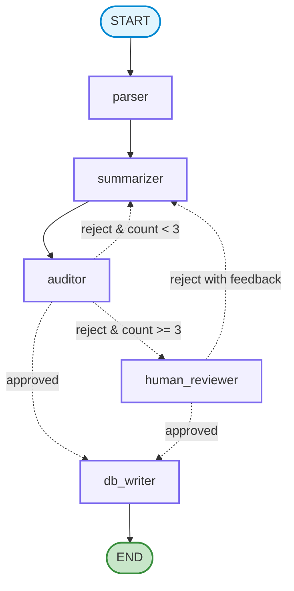

# System Architecture: The Enterprise Document Agent & Auditor

This document details the architectural blueprint of the system and tracks the **LangGraph concepts & learning stages** implemented across the project.

---

## 🏛️ System Architecture Diagram

---

## 📋 Core State Schema (`DocumentState`)

| Field | Type | Description |
| :--- | :--- | :--- |
| `file_path` | `str` | Path to the source document (.pdf, .txt, .md). |
| `document_content` | `str` | Raw text extracted by the `parser` node. |
| `summary` | `str` | Current draft generated/revised by `summarizer`. |
| `feedback` | `str \| None` | Actionable critique from `auditor` or admin feedback. |
| `status` | `Literal["approved", "rejected"] \| None` | Current audit/approval decision. |
| `maximum_iteration` | `int` | Hard cap on automated retries (default: `3`). |
| `iteration_count` | `int` | Number of reflection revisions completed so far. |

---

## 🧠 LangGraph Learning Progression & Coverage

This project covers concepts across all three developmental stages of LangGraph:

### 🟢 Stage 1: Beginner (Core Foundations) — *Covered & Implemented*
- [x] **`StateGraph` Canvas:** Modeling state schemas via Pydantic (`DocumentState`).
- [x] **Node Contracts:** Designing pure worker functions that read state and return state deltas (`nodes.py`).
- [x] **Linear Edges:** Direct node connections via `workflow.add_edge()`.
- [x] **Conditional Edges:** Branching functions (`route_after_audit`, `route_after_human_review`) with explicit `path_map` validation.
- [x] **Cyclical Feedback Loops:** Autonomous Evaluator-Optimizer reflection loop that revises drafts based on feedback.
- [x] **Graph Compilation & Visual Rendering:** `workflow.compile()` and visual diagram generation (`draw_mermaid_png`).

---

### 🟡 Stage 2: Intermediate (State Persistence & HITL) — *Upcoming in Weeks 2 & 3*
- [ ] **Database Checkpointing (`PostgresSaver`):** Persisting state snapshots into PostgreSQL tables after each node execution.
- [ ] **Thread & Session Management:** Managing concurrent executions across documents using `thread_id`.
- [ ] **State Inspection & Time-Travel:** Querying `app.get_state(config)` to inspect historical snapshots and audit revisions.
- [ ] **Human-in-the-Loop (HITL) Integration:** Pausing execution on escalation, collecting human approval/feedback, and resuming state.
- [ ] **Event & Token Streaming:** Using `app.stream()` / `app.astream_events()` to stream node progress and tokens to the FastAPI API.

---

### 🔴 Stage 3: Pro (Enterprise Scale & Deployment) — *Addressed in Weeks 3 & 4*
- [ ] **Production Async Architecture:** Non-blocking async connections with PostgreSQL and connection pooling (`asyncpg`).
- [ ] **Containerized Deployment:** Packaging the compiled graph engine inside Docker containers with `uv`.
- [ ] **Kubernetes Orchestration:** Auto-scaling application pods under heavy document load using K8s HPA.
- [ ] **Observability & Tracing:** Integrating **LangSmith** to monitor step-by-step latency, token costs, and auditor rejection benchmarks.

---

## 🚫 What is NOT Covered in this Project (Reserved for Future Architectures)

To keep this project focused and maintain high production standards, the following advanced LangGraph features are intentionally out of scope:

1. **Hierarchical Subgraphs (Graphs within Graphs):**
   * *What it is:* Nesting an entire child `StateGraph` as a single node inside a parent graph.
   * *Why omitted:* Our 5-node Evaluator-Optimizer workflow is self-contained. Subgraphs would add unnecessary indirection and complexity.

2. **Multi-Agent Supervisor & Dynamic Handoffs (`Command(goto=...)`):**
   * *What it is:* Multiple distinct autonomous LLM personas (e.g., Researcher Agent $\leftrightarrow$ Writer Agent $\leftrightarrow$ Tester Agent) debating and delegating tasks dynamically.
   * *Why omitted:* Our architecture is an **Evaluator-Optimizer reflection pattern** (Worker + Critic), not a multi-agent debate swarm.

3. **Dynamic Parallel Fan-Out / Map-Reduce (`Send` API):**
   * *What it is:* Dynamically spawning $N$ parallel nodes at runtime to process 50 document chunks simultaneously and merging results.
   * *Why omitted:* Documents are processed sequentially per workflow session to maintain strict context continuity for the Auditor.

4. **LangGraph Cloud / Hosted Studio (Proprietary SaaS):**
   * *What it is:* Commercial hosted cloud platform by LangChain Inc.
   * *Why omitted:* We are building a **100% self-hosted, cloud-native enterprise system** using open-source tools (FastAPI, Docker, Kubernetes, AWS EKS/ECS).